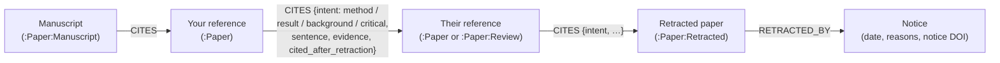

# Load-Bearing

**Find which draft claims depend on retracted research, even when the cited paper has no retraction notice.**

Load-Bearing is a pre-submission evidence audit for systematic-review teams and their drafting agents. It follows a claim to the cited outcome, the study included in that outcome, and the dated publication notice. Reviewers get the figure or section to recheck. Agents get the same evidence through MCP.

[Open the two-claim demo](https://rebell-leader.github.io/load-bearing/viewer/claims.html) · [Claim pilot](docs/CLAIM_PILOT.md) · [New-source evaluation](docs/CLAIM_PILOT.md#evaluation-on-new-reviews) · [Demo video instructions](docs/DEMO.md)

## Try the claim audit

Two draft sentences cite the same meta-analysis. The rat cognitive-function result included study 44, which was later retracted. The mouse result used different studies. The audit points to Figures 3b and 3a and recommends reassessing the rat estimate. [Published review](https://link.springer.com/article/10.1186/s13287-022-03231-1#Fig3) · [Publisher notice](https://doi.org/10.1007/s11011-023-01282-8)

Open `viewer/claims.html` directly from the checkout, or run the audit in [Relate](https://relatedb.ai). Git and dependency installation need network access. The claim audit runs offline after installation, with no API keys. Requires Python 3.12+ and [uv](https://docs.astral.sh/uv/).

```bash
git clone https://github.com/Rebell-Leader/load-bearing.git && cd load-bearing
uv sync --locked
uv run --offline --no-sync loadbearing audit
```

```bash
uv run --offline --no-sync loadbearing audit --mode direct
uv run --offline --no-sync loadbearing audit --as-of 2023-08-01
uv run --offline --no-sync loadbearing audit --example recommender
uv run --offline --no-sync pytest -q
```

The command reads the checked-in [claim store](data/claims.rl). The browser shows an interactive report exported from that same file. Use the separate [citation explorer](https://rebell-leader.github.io/load-bearing/viewer/) to run Cypher in WebAssembly on the broader literature graph.

### Audit a new review

Start with an inclusion table whose outcome-to-study links have been checked by a reviewer. Preview the rows before adding them to a local Relate store. The example includes five reviews outside the original pilot.

```bash
audit_dir="$(mktemp -d)"
uv run --offline --no-sync loadbearing import-outcomes data/claim_eval/outcomes.csv \
  --notices data/claim_eval/notices.csv --as-of 2026-11-16 --store "$audit_dir/claims.rl"
```

Open the links in the preview and check the study DOI and figure or section. Rerun with `--confirm` to save the reviewed evidence, then audit the example claims.

```bash
uv run --offline --no-sync loadbearing import-outcomes data/claim_eval/outcomes.csv \
  --notices data/claim_eval/notices.csv --as-of 2026-11-16 --store "$audit_dir/claims.rl" --confirm
uv run --offline --no-sync loadbearing audit data/claim_eval/claims.json --store "$audit_dir/claims.rl"
```

The source table schema, claim input, and measured coverage are in [the new-review evaluation](docs/CLAIM_PILOT.md#evaluation-on-new-reviews).

## Use case

Retracted papers keep getting cited. A bibliography check can identify a notice on a direct reference. A systematic reviewer also needs to know which results in that reference used a retracted study. [VITALITY](https://pmc.ncbi.nlm.nih.gov/articles/PMC12015725/) documented this dependency in 847 systematic reviews.

A claim audit uses reviewed outcome links. For a larger bibliography, `loadbearing check` follows citation paths up to three hops, reads available passages, and ranks possible reliance for a human reviewer.

The relationships that matter:



| Relationship or property | Why it matters |
|---|---|
| `CITES.intent` | A method or result citation means reliance. A background mention doesn't. |
| `CITES.context`, `section`, `evidence` | The citing sentence and where it came from (`fulltext`, `s2`), or that only metadata was seen. |
| `CITES.zombie` | The citing paper appeared after the retraction. |
| `CITES.anachronistic` / `year_conflict` | The cited paper is dated 2+ years after the citing one. Bad upstream data: excluded, or for a retracted target, never counted as load-bearing. Reports list them. |
| `(:Retracted)-[:RETRACTED_BY]->(:Notice)` | What the notice says (nature, date, reasons). Load-Bearing reports notices, never misconduct. |
| `:Review` | Citing a review isn't relying on primary evidence. |

## How it uses Relate

The claim store is a **single `.rl` file** so a reviewer can pass around and inspect the exact evidence used for an audit. Embedded Relate queries traverse the cited work to its outcome, the outcome's relationship to the study, and the study's publication notices. Dates are evaluated against the cutoff in the claim request.

```text
(:ClaimWork)-[:REPORTS]->(:Outcome)-[:STUDY_USE {role}]->(:ClaimWork)-[:HAS_NOTICE]->(:PublicationNotice)
```

The broader citation check has its own graph and explorer.

- **Modes: a single file, a directory, and in-memory in the browser.** Each one is used for a reason.
  - **Single file, `data/demo.rl`, is the evidence pack.** One file you can hand to an editor, open
    read-only, back up by copying, and query offline. Checks never write to it.
  - **Directory, `data/evidence/`, is the working graph.** Load-Bearing is its only writer. Relate's own
    MCP server follows it with `relate serve --mcp stdio --read-only=live`, so a new check can be queried
    through `read_cypher` as soon as it commits. A `.rl` file can't do this: while a reader holds it,
    Relate refuses any writer (`storage locked`). The directory was made with
    `relate clone data/demo.rl data/evidence`.
  - **In-memory WebAssembly, in [`viewer/`](viewer/).** The browser build can't open `.rl` files, so the
    page loads an exported pack into an in-memory `RelateDb` and runs the same statements.
- **What the graph models:** papers, typed citations, reviews, retraction notices (diagram above). The
  core of the product is one Cypher statement in [`store.py`](src/loadbearing/store.py). It finds every
  path from the manuscript to a retracted paper and computes a status from the intents on its edges. Its
  load-bearing form:

```cypher
MATCH p = (m:Manuscript {id: $root})-[c0:CITES WHERE NOT coalesce(c0.anachronistic, false)]->(:Paper)
          (()-[c:CITES WHERE c.intent IN ['method', 'result']
                     AND NOT coalesce(c.anachronistic, false) AND NOT coalesce(c.year_conflict, false)]->()){0,2}
          (bad:Retracted)
RETURN bad.title AS retracted, [x IN nodes(p) | x.title] AS chain, length(p) AS hops
```

The portable snapshot returns 739 exposure paths. The browser pack also adds the grant draft to a
copy of that snapshot and returns 741 for the same published paper. Both return 30 candidate paths
to 23 flagged works when filtered by citation intent.

**The same statements run in three places:**

| Where | How it reaches Relate |
|---|---|
| CLI | `relate-db` (Python, embedded) |
| MCP server | `relate-db` (Python, embedded) |
| Agent follow-up questions | Relate's own MCP server (`relate serve`) |
| Browser viewer | `@relate/relate-wasm` |

**Relate features used:**

- quantified path patterns with inline relationship predicates
- list predicates (`all`, `any`) over path relationships
- pattern comprehensions
- `date` values and temporal notice cutoffs (`as_of`)
- uniqueness constraints, range indexes, a full-text index (`SEARCH ... IN (FULLTEXT INDEX ...)`), and a vector index (`SEARCH ... IN (VECTOR INDEX ...)`)
- saving an agent's claim-by-claim review decisions (`(:Manuscript)-[:HAS_CLAIM]->(:Claim)-[:HAS_DISPOSITION]->(:Disposition)`) back into the graph
- single-file and directory stores, and `relate clone` to convert between them
- read-only opens from Python
- `relate serve --mcp stdio --read-only=live` following a writer
- the WebAssembly build

## Setup and run

Prerequisites: Python 3.12+ and uv. For the Relate MCP server and the agent demo, also the
[Relate CLI](https://relatedb.ai/docs/get-started/install/).

```bash
uv sync                                                              # core: relate-db + MCP SDK
uv run loadbearing check --doi 10.1016/j.redox.2025.103611 --store data/demo.rl --offline
uv run loadbearing check examples/redox2025.bib                      # live check of a .bib (adds to data/evidence)
uv run loadbearing check --doi 10.1016/j.redox.2025.103611 --json    # a published paper, JSON for agents
```

The bibliography command exits with status `1` when it reports direct or load-bearing findings and `2` when it cannot look up an offline manuscript.

A live check calls free scholarly APIs (OpenAlex, Europe PMC, Semantic Scholar, Crossref) and caches
every response in `data/raw/cache/`. Without a key, OpenAlex gives each IP a small shared daily budget,
enough for about one cold three-hop check. Set `OPENALEX_API_KEY` (free at openalex.org) for regular use.
For notice reasons, download the Retraction Watch database (opened by Crossref). Without it, Crossref
notice links still give dates.

```bash
curl -L -o data/raw/retraction_watch.csv https://gitlab.com/crossref/retraction-watch-data/-/raw/main/retraction_watch.csv
```

### For agents: MCP server and skill

Opening this repository in Claude Code picks up [`.mcp.json`](.mcp.json) and the
[`load-bearing` skill](skills/load-bearing/SKILL.md). The Load-Bearing MCP server exposes seven tools:

| Tool | What it does |
|---|---|
| `retraction_status` | Check DOI notices and distinguish an unconfirmed OpenAlex flag. Builds no graph |
| `check_references` | Exposure report for a bibliography (BibTeX or DOIs), mapped back to your `.bib` keys; can also save claim-level review decisions to the graph |
| `check_paper` | The same for a published paper, reading its own full text for the first hop |
| `audit_claims` | Read-only claim audit from `data/claims.rl`. Set `LOADBEARING_CLAIM_STORE` to point it at a reviewed import. |
| `explain_exposure` | Up to 30 paths from a manuscript to one flagged paper (by OpenAlex ID, DOI, or title search), with available citing sentences |
| `graph_schema` | Labels, counts, data-quality flags and example Cypher |
| `query_graph` | Read-only Cypher. The store opens with `read_only=True`, so Relate refuses writes |

`.mcp.json` also starts Relate's own server (`read_cypher` and `get_schema`) on the same directory store.
For other hosts, use the same blocks with absolute paths. Verify both servers side by side:

```bash
uv run python scripts/mcp_smoke.py    # checks on a temporary clone; needs network and the Relate CLI
```

### Agent demo

A Claude agent (Claude Agent SDK, Claude Opus 5.5) audits a research assistant's grant paragraph with only
the two MCP servers and no other tools. It finds both retracted references and reads the flagged sentences
before acting. It queries the graph through Relate's `read_cypher` and catches an impossible upstream
citation. Then it rewrites the paragraph without inventing references. Recorded run:
[`runs/agent_demo.md`](runs/agent_demo.md), 9 turns, 111 s, $0.50. Video script: [docs/DEMO.md](docs/DEMO.md).

```bash
uv sync --group demo
uv run --group demo python scripts/agent_demo.py --budget 3   # ANTHROPIC_API_KEY or a Claude Code login
```

### Browser viewer

Open the [hosted copy](https://rebell-leader.github.io/load-bearing/viewer/), or run `python3 -m http.server 8765` and open
`http://localhost:8765/viewer/`. Pick a manuscript, browse
retracted papers by status, see the citation paths as a diagram with the citing sentences, and run Cypher
in the tab. Details: [viewer/README.md](viewer/README.md).

### Citation intent and evaluation

Intent v1 ([`intent.py`](src/loadbearing/intent.py)) checks, in order:

1. a strong critical cue (retraction, failed replication, "alleged");
2. a method citation: a Methods section, or a BiomedBERT model fine-tuned on SciCite. The model is optional
   (`uv sync --group train`); rules stand in without it;
3. the cited work's type: citing a review is background, citing primary research is a result citation,
   unless the sentence is vague or cites three or more references with no specific finding.

| Measured | Result |
|---|---|
| Path filtering on the 2025 Alzheimer's paper | 739 untyped paths (349 works) → 30 load-bearing paths (23 works): **96% fewer paths to review** |
| BiomedBERT on SciCite test (`n = 1,861`) | **0.856 macro-F1** (rules v0: 0.603) |
| v1 on held-out in-domain sentences (`n = 60`) | finds **69% of real reliance** at 33% precision (rules v0: 8% / 17%) |
| Claim-level pilot (`17` cases across `6` reviews, [`docs/CLAIM_PILOT.md`](docs/CLAIM_PILOT.md)) | **17/17 correct review actions**, **6/6 indirect retractions caught**, **0/6 false alarms on unaffected claims** (direct DOI check: 6/17; untyped paths: 12/17 with 5/6 false alarms) |

So every finding shows its sentence, and a person decides. Method, negative results and caveats are in
[docs/EVAL.md](docs/EVAL.md), and the claim-level benchmark with PaperOrchestra is in
[docs/CLAIM_PILOT.md](docs/CLAIM_PILOT.md). The sentence-level labels are Claude's, made blind; an
`expert_label` column is ready for expert correction.

```bash
uv run python scripts/eval_scicite.py
uv sync --group train && HF_HUB_OFFLINE=1 uv run --group train python scripts/train_intent.py
HF_HUB_OFFLINE=1 uv run --group train python scripts/eval_indomain.py --set heldout --model models/intent-biomedbert-scicite
uv run python scripts/run_claim_comparison.py --output /tmp/loadbearing-graph-pilot
```

## Where the data lives

| Path | What |
|---|---|
| `data/claims.rl` | Single-file claim audit snapshot for both featured cases and the curated comparison |
| `data/claim_eval/` | Reviewed inclusion tables, draft inputs, and source-backed labels for five additional reviews |
| `data/demo.rl` | Evidence pack for the demo paper: a single-file Relate store, 926 papers, 1,305 citations, 349 marked retracted (317 with a retraction notice) |
| `data/evidence/` | Working graph: a directory store. CLI and MCP checks add to it; Relate's MCP server follows it |
| `viewer/evidence.json` | The pack exported for the browser (the demo paper plus the agent demo's grant draft) |
| `data/eval/` | Labelled samples, guideline, predictions |
| `runs/` | Recorded outputs: CLI report, agent transcript, evaluation results |
| `data/raw/` | Downloads and the HTTP cache (git-ignored) |

## Status labels

| Label | Meaning |
|---|---|
| direct | You cite a retracted paper. |
| load-bearing | Every citation after yours on the path is a method or result citation. |
| unverified | A citation on the path couldn't be read, or its dates conflict. |
| mention-only | The path passes through a background mention. |
| defused | A paper on the path already flags the problem (retraction, failed replication). |

Paths are evidence for a person to review, not verdicts about any paper or author.

## Limitations

- Claim results are scoped to the evidence and dates in the store. Confirmed outcome IDs cover paraphrases. Ambiguous or missing outcome matches produce an abstention.

- Citation intent v1 is a lead generator: 33% precision on held-out sentences.
- About half of the citations on paths can't be read, because there's no open full text. They show as
  unverified, never as exposure.
- The graph stores only citations on paths to retracted work, so "no path" means "nothing found", not
  "clean".
- OpenAlex marks some papers retracted that have no retraction notice in Retraction Watch or Crossref
  (32 of 349 in the demo store: 28 with no notice at all, 4 with only a correction or expression of
  concern). The report labels each one. Agents receive `notice_on_record: false`; direct DOI checks
  use `marked_retracted` for a flag without a notice and return any correction or concern distinctly.
- Upstream citation metadata can be wrong. Date-impossible citations are filtered; other errors can remain.

## Data sources

| Source | Used for |
|---|---|
| [OpenAlex](https://openalex.org) (CC0) | works, references, retraction flags, work types |
| [Retraction Watch database via Crossref](https://gitlab.com/crossref/retraction-watch-data) | notice dates and reasons |
| [Crossref REST API](https://www.crossref.org/documentation/retrieve-metadata/rest-api/) | notice links for papers Retraction Watch hasn't recorded |
| [Europe PMC](https://europepmc.org) | open-access full text for citing sentences |
| [Semantic Scholar API](https://www.semanticscholar.org/product/api) | fallback citing sentences and intents |
| [SciCite](https://github.com/allenai/scicite) (Apache-2.0) | intent model training and evaluation |

Citing sentences shown in reports are short quotations, each traceable to its source paper.

## Project layout

```
src/loadbearing/   cli.py · mcp_server.py · check.py · expand.py · store.py (all Cypher) · claim_audit.py
                   intent.py · fulltext.py · openalex.py · crossref.py · retractionwatch.py · s2.py · bib.py · intent_model.py · evaluate.py
scripts/           agent_demo.py · run_claim_comparison.py · mcp_smoke.py · export_viewer.py · record_demo.py · train_intent.py · eval_*.py · probe_dialect.py
skills/            load-bearing/SKILL.md (linked into .claude/skills/)
viewer/            index.html · evidence.json
docs/              EVAL.md · CLAIM_PILOT.md · DEMO.md · SUBMISSION.md · SPIKE.md
```

## License

Apache-2.0 (see [LICENSE](LICENSE)), the same license as Relate.
