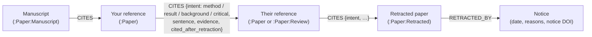

# Load-Bearing

**Not every citation matters. Load-Bearing finds the ones carrying the weight, and tells you when one has collapsed.**

Load-Bearing checks a bibliography, or any published paper, for reliance on retracted science. It
follows citations up to three hops out in a [Relate](https://relatedb.ai) graph, reads the sentence where
each citation appears, and separates papers that *used* a retracted result or method from papers that only
*mentioned* it. Researchers use it from the command line or in the browser; AI research agents use it
through MCP.

On a real 2025 Alzheimer's paper, 56 of its 72 references reach a retracted paper within three citation
hops. 23 of those paths run only through method or result citations, including Lesné 2006 (Aβ*56,
retracted in 2024).

**Demo video:** _link added at submission_ · **Agent run:** [`runs/agent_demo.md`](runs/agent_demo.md) ·
**Browser viewer:** [`viewer/`](viewer/) · **Evaluation:** [`docs/EVAL.md`](docs/EVAL.md)

## Try it in two minutes

No network, no API keys. Needs Python 3.12+ and [uv](https://docs.astral.sh/uv/).

```bash
git clone https://github.com/Rebell-Leader/load-bearing.git && cd load-bearing
uv sync
uv run loadbearing check --doi 10.1016/j.redox.2025.103611 --store data/demo.rl --offline
```

That prints the full report for the demo paper from the shipped Relate store
([sample output](runs/redox2025.txt)). Then:

```bash
python3 -m http.server 8765        # open http://localhost:8765/viewer/ : the same graph, in the browser
uv run pytest -q                   # 12 offline tests, including Relate path queries
```

With the [Relate CLI](https://relatedb.ai/docs/get-started/install/) installed, you can query the store
directly:

```bash
relate --database data/demo.rl --read-only \
  "MATCH (m:Manuscript)-[:CITES]->(b:Paper)-[:CITES]->{0,2}(bad:Retracted)
   RETURN bad.title AS retracted, count(DISTINCT b) AS via_references ORDER BY via_references DESC LIMIT 5"
```

## Use case

Retracted papers keep getting cited, and AI research tools repeat them. A 2026 JMIR study tested nine
generative AI tools, including ChatGPT, Claude, Gemini and Perplexity; none consistently identified or
excluded retracted articles. Reference managers flag a retracted paper you cite *directly*. Nothing common
answers the second-order question: **does a paper I rely on get its key result from a retracted study?**

Who it's for:

- **Peer reviewers and editors.** Bibliographies stay on their machine; nothing needs a server.
- **Systematic-review teams.** One demo finding is a meta-analysis that pooled a study later retracted
  for image manipulation.
- **Research-integrity officers.**
- **AI research agents.** An MCP server and a "check before you cite" skill.

The relationships that matter:



| Relationship or property | Why it matters |
|---|---|
| `CITES.intent` | A method or result citation means reliance. A background mention doesn't. |
| `CITES.context`, `section`, `evidence` | The citing sentence and where it came from (`fulltext`, `s2`), or that only metadata was seen. |
| `CITES.zombie` | The citing paper appeared after the retraction. |
| `CITES.anachronistic` / `year_conflict` | The cited paper is dated 2+ years after the citing one. Bad upstream data: excluded, or for a retracted target, never counted as load-bearing. Reports list them. |
| `(:Retracted)-[:RETRACTED_BY]->(:Notice)` | What the notice says (nature, date, reasons). Load-Bearing reports notices, never misconduct. |
| `:Review` | Citing a review isn't relying on primary evidence. |

## How it uses Relate

- **Modes: a single file, a directory, and in-memory in the browser.** Each one is used for a reason.
  - **Single file, `data/demo.rl`, is the evidence pack.** One file you can hand to an editor, open
    read-only, back up by copying, and query offline. Checks never write to it.
  - **Directory, `data/evidence/`, is the working graph.** Load-Bearing is its only writer. Relate's own
    MCP server follows it with `relate serve --mcp stdio --read-only=live`, so a new check can be queried
    through `read_cypher` as soon as it commits. A `.rl` file can't do this: while a reader holds it,
    Relate refuses any writer (`storage locked`). The directory was made with
    `relate clone data/demo.rl data/evidence`.
  - **In-memory WebAssembly, in [`viewer/`](viewer/).** The browser build can't open `.rl` files, so the
    page loads an exported pack into an in-memory `RelateDb` and runs the same statements.
- **What the graph models:** papers, typed citations, reviews, retraction notices (diagram above). The
  core of the product is one Cypher statement in [`store.py`](src/loadbearing/store.py). It finds every
  path from the manuscript to a retracted paper and computes a status from the intents on its edges. Its
  load-bearing form:

```cypher
MATCH p = (m:Manuscript {id: $root})-[c0:CITES WHERE NOT coalesce(c0.anachronistic, false)]->(:Paper)
          (()-[c:CITES WHERE c.intent IN ['method', 'result']
                     AND NOT coalesce(c.anachronistic, false) AND NOT coalesce(c.year_conflict, false)]->()){0,2}
          (bad:Retracted)
RETURN bad.title AS retracted, [x IN nodes(p) | x.title] AS chain, length(p) AS hops
```

On the demo graph, the load-bearing query takes 1.5 ms. The full exposure query, which classifies all
741 paths, takes 30 ms through `relate serve` and about 100 ms in the browser.

**The same statements run in three places:**

| Where | How it reaches Relate |
|---|---|
| CLI | `relate-db` (Python, embedded) |
| MCP server | `relate-db` (Python, embedded) |
| Agent follow-up questions | Relate's own MCP server (`relate serve`) |
| Browser viewer | `@relate/relate-wasm` |

**Relate features used:**

- quantified path patterns with inline relationship predicates
- list predicates (`all`, `any`) over path relationships
- pattern comprehensions
- `date` values
- uniqueness constraints and a full-text index
- single-file and directory stores, and `relate clone` to convert between them
- read-only opens from Python
- `relate serve --mcp stdio --read-only=live` following a writer
- the WebAssembly build

## Setup and run

Prerequisites: Python 3.12+ and uv. For the Relate MCP server and the agent demo, also the
[Relate CLI](https://relatedb.ai/docs/get-started/install/).

```bash
uv sync                                                              # core: relate-db + MCP SDK
uv run loadbearing check examples/redox2025.bib                      # live check of a .bib (adds to data/evidence)
uv run loadbearing check --doi 10.1016/j.redox.2025.103611 --json    # a published paper, JSON for agents
```

A live check calls free scholarly APIs (OpenAlex, Europe PMC, Semantic Scholar, Crossref) and caches
every response in `data/raw/cache/`. Without a key, OpenAlex gives each IP a small shared daily budget,
enough for about one cold three-hop check. Set `OPENALEX_API_KEY` (free at openalex.org) for regular use.
For notice reasons, download the Retraction Watch database (opened by Crossref). Without it, Crossref
notice links still give dates.

```bash
curl -L -o data/raw/retraction_watch.csv https://gitlab.com/crossref/retraction-watch-data/-/raw/main/retraction_watch.csv
```

### For agents: MCP server and skill

Opening this repository in Claude Code picks up [`.mcp.json`](.mcp.json) and the
[`load-bearing` skill](skills/load-bearing/SKILL.md). The Load-Bearing MCP server exposes six tools over
the graph:

| Tool | What it does |
|---|---|
| `retraction_status` | Is this DOI retracted, corrected, or under an expression of concern? Instant; builds no graph |
| `check_references` | Exposure report for a bibliography (BibTeX or DOIs), mapped back to your `.bib` keys |
| `check_paper` | The same for a published paper, reading its own full text for the first hop |
| `explain_exposure` | Every path from a manuscript to one retracted paper, with the citing sentences |
| `graph_schema` | Labels, counts, data-quality flags and example Cypher |
| `query_graph` | Read-only Cypher. The store opens with `read_only=True`, so Relate refuses writes |

`.mcp.json` also starts Relate's own server (`read_cypher` and `get_schema`) on the same directory store.
For other hosts, use the same blocks with absolute paths. Verify both servers side by side:

```bash
uv run python scripts/mcp_smoke.py    # 12 checks on a temporary clone; needs network and the Relate CLI
```

### Agent demo

A Claude agent (Claude Agent SDK, Claude Opus 5.5) audits a research assistant's grant paragraph with only
the two MCP servers and no other tools. It finds both retracted references and reads the flagged sentences
before acting. It queries the graph through Relate's `read_cypher` and catches an impossible upstream
citation. Then it rewrites the paragraph without inventing references. Recorded run:
[`runs/agent_demo.md`](runs/agent_demo.md), 9 turns, 111 s, $0.50. Video script: [docs/DEMO.md](docs/DEMO.md).

```bash
uv sync --group demo
uv run --group demo python scripts/agent_demo.py --budget 3   # ANTHROPIC_API_KEY or a Claude Code login
```

### Browser viewer

`python3 -m http.server 8765`, then open `http://localhost:8765/viewer/`. Pick a manuscript, browse
retracted papers by status, see the citation paths as a diagram with the citing sentences, and run Cypher
in the tab. Details: [viewer/README.md](viewer/README.md).

### Citation intent and evaluation

Intent v1 ([`intent.py`](src/loadbearing/intent.py)) checks, in order:

1. a strong critical cue (retraction, failed replication, "alleged");
2. a method citation: a Methods section, or a BiomedBERT model fine-tuned on SciCite. The model is optional
   (`uv sync --group train`); rules stand in without it;
3. the cited work's type: citing a review is background, citing primary research is a result citation,
   unless the sentence is vague or cites three or more references with no specific finding.

| Measured | Result |
|---|---|
| BiomedBERT on SciCite test | 0.856 macro-F1 (rules: 0.603) |
| v1 on held-out in-domain sentences | finds 69% of real reliance at 33% precision (rules v0: 8% / 17%) |

So every finding shows its sentence, and a person decides. Method, negative results and caveats are in
[docs/EVAL.md](docs/EVAL.md). The labels are Claude's, made blind; an `expert_label` column is ready
for expert correction.

```bash
uv run python scripts/eval_scicite.py
uv sync --group train && HF_HUB_OFFLINE=1 uv run --group train python scripts/train_intent.py
HF_HUB_OFFLINE=1 uv run --group train python scripts/eval_indomain.py --set heldout --model models/intent-biomedbert-scicite
```

## Where the data lives

| Path | What |
|---|---|
| `data/demo.rl` | Evidence pack for the demo paper: a single-file Relate store, 926 papers, 1,305 citations, 349 retracted |
| `data/evidence/` | Working graph: a directory store. CLI and MCP checks add to it; Relate's MCP server follows it |
| `viewer/evidence.json` | The pack exported for the browser (the demo paper plus the agent demo's grant draft) |
| `data/eval/` | Labelled samples, guideline, predictions |
| `runs/` | Recorded outputs: CLI report, agent transcript, evaluation results |
| `data/raw/` | Downloads and the HTTP cache (git-ignored) |

## Status labels

| Label | Meaning |
|---|---|
| direct | You cite a retracted paper. |
| load-bearing | Every citation after yours on the path is a method or result citation. |
| unverified | A citation on the path couldn't be read, or its dates conflict. |
| mention-only | The path passes through a background mention. |
| defused | A paper on the path already flags the problem (retraction, failed replication). |

Paths are evidence for a person to review, not verdicts about any paper or author.

## Limitations

- Citation intent v1 is a lead generator: 33% precision on held-out sentences.
- About half of the citations on paths can't be read, because there's no open full text. They show as
  unverified, never as exposure.
- The graph stores only citations on paths to retracted work, so "no path" means "nothing found", not
  "clean".
- Some retracted works have no notice in Retraction Watch or Crossref; they show OpenAlex's flag only.
- Upstream citation metadata can be wrong. Date-impossible citations are filtered; other errors can remain.

## Data sources

| Source | Used for |
|---|---|
| [OpenAlex](https://openalex.org) (CC0) | works, references, retraction flags, work types |
| [Retraction Watch database via Crossref](https://gitlab.com/crossref/retraction-watch-data) | notice dates and reasons |
| [Crossref REST API](https://www.crossref.org/documentation/retrieve-metadata/rest-api/) | notice links for papers Retraction Watch hasn't recorded |
| [Europe PMC](https://europepmc.org) | open-access full text for citing sentences |
| [Semantic Scholar API](https://www.semanticscholar.org/product/api) | fallback citing sentences and intents |
| [SciCite](https://github.com/allenai/scicite) (Apache-2.0) | intent model training and evaluation |

Citing sentences shown in reports are short quotations, each traceable to its source paper.

## Project layout

```
src/loadbearing/   cli.py · mcp_server.py · check.py · expand.py · store.py (all Cypher) · intent.py · fulltext.py
                   openalex.py · crossref.py · retractionwatch.py · s2.py · bib.py · intent_model.py · evaluate.py
scripts/           agent_demo.py · mcp_smoke.py · export_viewer.py · train_intent.py · eval_*.py · probe_dialect.py
skills/            load-bearing/SKILL.md (linked into .claude/skills/)
viewer/            index.html · evidence.json
docs/              EVAL.md · DEMO.md · SPIKE.md (build notes)
```

## License

Apache-2.0 (see [LICENSE](LICENSE)), the same license as Relate.
